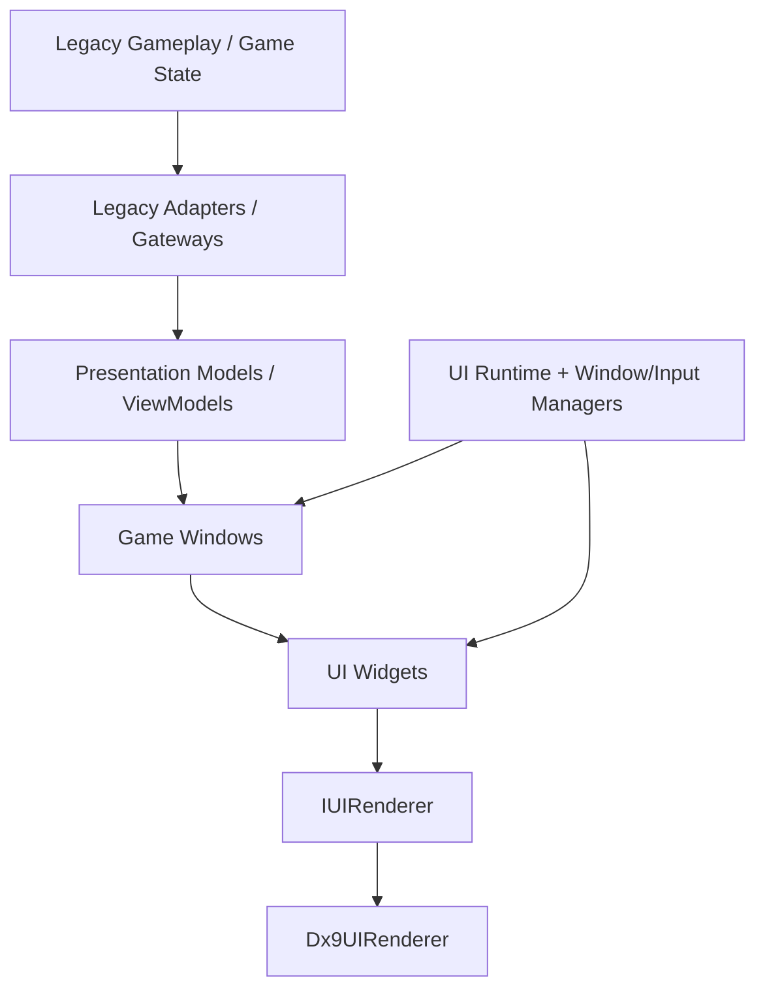
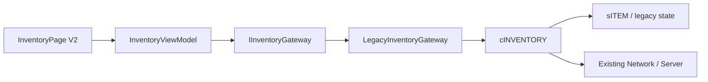
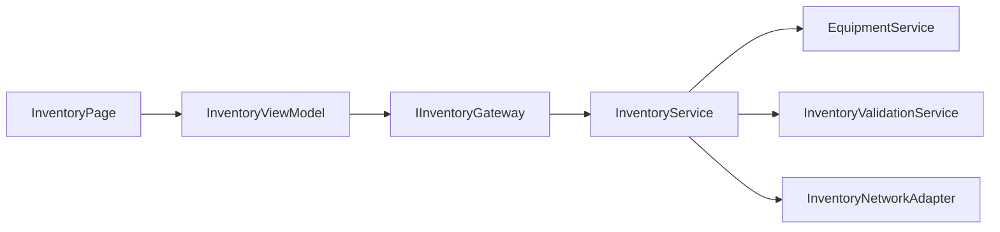
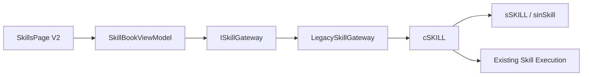
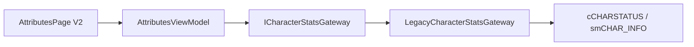

# Plano de Engenharia — Modernização do Sistema de UI

**Projeto:** Source atual / base legada Priston-like  
**Escopo principal:** Inventário, Atributos/Status e Habilidades  
**Formato:** Roadmap técnico + arquitetura alvo + plano de migração  
**Data da análise:** 2026-09-14  
**Status:** Proposta de arquitetura

---

## 1. Resumo executivo

A source permite uma modernização ampla da interface sem exigir troca imediata da engine, do renderer 3D ou dos protocolos cliente/servidor. A recomendação é **não reescrever o jogo inteiro nem substituir `cINVENTORY`, `cCHARSTATUS` e `cSKILL` de uma vez**. O caminho de menor risco é introduzir uma nova camada de UI, isolada do legado, e migrar as telas progressivamente.

A arquitetura atual mistura em uma mesma classe:

- estado de gameplay;
- desenho de interface;
- carregamento de textura;
- detecção de mouse;
- atalhos de teclado;
- regras de item/skill/status;
- chamadas de rede;
- validação/anticheat;
- efeitos visuais;
- lógica de quests/eventos especiais.

O caso mais extremo é o inventário: `sinInvenTory.cpp` possui aproximadamente **13.877 linhas** e concentra desde desenho da janela até equipar itens, poções, efeitos, quests antigas, validação de item e eventos sazonais.

O objetivo deste roadmap é chegar à seguinte regra:

> **A UI pode observar o estado do jogo e solicitar ações, mas não é dona das regras de gameplay.**

Ao final da migração, Inventário, Atributos e Habilidades devem existir como views modulares em uma janela de personagem, enquanto as regras existentes continuam funcionando através de gateways/adapters até serem gradualmente extraídas do legado.

A estratégia recomendada é do tipo **Strangler Migration**: criar UI V2 em paralelo, substituir uma tela por vez, manter feature flags para rollback e remover o código visual antigo somente depois da equivalência funcional.

---

## 2. Escopo desta modernização

### 2.1 Incluído

Este plano cobre:

- framework UI V2;
- renderização 2D da UI sobre DirectX 9;
- gerenciamento de janelas;
- input de mouse e teclado;
- foco, modal, captura de mouse e z-order;
- sistema de layout e escala;
- cache/gerenciamento de assets de UI;
- tema/skin;
- tooltips;
- drag-and-drop;
- janela unificada de personagem;
- nova UI de Inventário;
- nova UI de Equipamentos;
- nova UI de Atributos/Status;
- nova UI de Habilidades;
- adapters para os sistemas legados;
- testes e ferramentas de diagnóstico;
- plano de desativação das telas antigas.

### 2.2 Fora do escopo inicial

Não deve ser requisito da modernização inicial:

- trocar DirectX 9;
- reescrever o renderer 3D;
- reescrever toda a estrutura `sITEM`;
- reescrever o combate das skills;
- alterar o protocolo de rede por razões puramente visuais;
- reescrever todas as regras de inventário simultaneamente;
- converter todos os sistemas antigos do jogo para ECS/MVVM/etc.;
- implementar editor visual de UI antes da UI V2 estar estável.

Esses trabalhos podem acontecer posteriormente. A UI V2 deve, porém, ser criada de forma que uma futura troca do renderer não obrigue a reescrever todas as telas.

---

# 3. Diagnóstico da source atual

## 3.1 Build e renderer

O cliente é compilado atualmente como:

- arquitetura 32-bit;
- MinGW `i686-w64-mingw32-g++`;
- `-std=gnu++17`;
- DirectX 9.

O novo sistema pode, portanto, usar C++17, incluindo:

- `std::unique_ptr`;
- `std::shared_ptr` onde ownership compartilhado for realmente necessário;
- `std::optional`;
- `std::variant`;
- `std::function`;
- templates e RAII modernos.

Não há necessidade de abandonar DirectX 9 para modernizar a arquitetura da UI.

---

## 3.2 Framework de UI já existente

Existe uma camada em:

```text
SrcGame/src/systems/ui/core/
```

com elementos como:

```text
UIElement
UIWindow
UIImage
UIText
UIButton
UICheckbox
UICombobox
UIInput
UIListBox
UIListItem
UIItemFrame
UIVerticalScroll
UIHorizontalScroll
```

Ela é usada, por exemplo, pelo menu de Settings e pelo Roll Window.

Isso demonstra que a engine consegue operar uma árvore básica de componentes. Entretanto, esse framework não deve ser adotado sem refactor como arquitetura final.

### Problemas observados

#### Dependência direta do legado

`UIElement.h` inclui:

```cpp
#include "compat/legacy/sin/sinLinkHeader.h"
```

Assim, o componente mais básico de UI conhece praticamente o universo legado do jogo.

A dependência correta deve ser invertida:

```text
Legacy Game -> Adapter -> UI Presentation
```

não:

```text
UI Core -> todo o Legacy Game
```

---

#### Ownership manual

`UIWindow` mantém:

```cpp
vector<Element*> vElements;
```

com `new/delete` manual.

Além disso, a classe base `Element` não define destrutor virtual, apesar de elementos derivados serem destruídos através de `Element*`.

A UI V2 deve usar ownership explícito por RAII:

```cpp
std::vector<std::unique_ptr<Widget>> children_;
```

---

#### Ponteiros potencialmente não inicializados

`UIWindow` possui membros como `Background` e `bgSplit[]` sem inicialização in-class consistente entre todos os construtores. Isso torna o ciclo de vida frágil.

Na UI V2, todo recurso deve nascer em estado válido e possuir ownership determinístico.

---

#### Input descentralizado

Atualmente `sinMain.cpp` distribui eventos manualmente para diversos sistemas:

```text
cMessageBox
cInterFace
cCharStatus
cInvenTory
cSkill
cTrade
cItem
cShop
cSin3D
cSinHelp
cSinWarpGate
...
```

Isso cria dois problemas:

1. ordem de processamento passa a determinar comportamento;
2. cada nova janela exige editar o dispatcher central ou criar novos atalhos laterais.

Deve existir apenas um ponto de entrada moderno:

```cpp
if (uiRuntime.HandleInput(event))
    return; // evento consumido pela UI
```

O evento só chega ao mundo/legado quando a UI não o consumir.

---

#### Controle de janela por `OpenFlag`

O legado utiliza amplamente:

```cpp
cCharStatus.OpenFlag
cInvenTory.OpenFlag
cSkill.OpenFlag
cTrade.OpenFlag
...
```

Também há código responsável por fechar manualmente outras telas ao abrir uma nova.

Isso deve ser substituído por:

```text
UIWindowManager
UIWindowPolicy
UIModalManager
```

com regras de coexistência declaradas centralmente.

---

#### Falta de foco real

`UIWindow::OnKeyDown()` encaminha teclado para múltiplos filhos. Não existe um sistema robusto de:

- keyboard focus;
- pointer capture;
- tab focus;
- modal focus;
- prioridade de popup;
- shortcut context.

Isso se torna crítico quando forem adicionados campos de busca, filtros, context menu, drag-and-drop e novas janelas.

---

#### Rendering e asset management acoplados

`UIImage` conhece diretamente `LPDIRECT3DTEXTURE9`.

O cache atual utiliza uma lista global de imagens e `ClearLoadedImages()` apenas limpa o vetor. Isso não constitui uma política moderna de ownership de recurso.

Widgets novos não devem conhecer `LPDIRECT3DTEXTURE9`.

O DirectX deve ficar atrás de uma interface de renderer.

---

#### `UIItemFrame` conhece o inventário global

O widget atual acessa diretamente:

```cpp
MouseItem
sITEM
cItem
ResetInvenItemCode()
```

Além disso, realiza `memcpy`/`ZeroMemory` do item no próprio widget.

Isso é exatamente o tipo de acoplamento que a UI V2 deve proibir.

Um `ItemSlot` deve somente emitir:

```cpp
OnItemClicked
OnDragStarted
OnDropRequested
OnContextRequested
```

A movimentação real do item deve ser decidida pelo `InventoryGateway`/domínio.

---

## 3.3 Estado do Inventário

Arquivos principais:

```text
SrcGame/src/systems/inventory/legacy/sinInvenTory.h
SrcGame/src/systems/inventory/legacy/sinInvenTory.cpp
Shared/inventory/legacy/sinItem_legacy_client.h
```

Características observadas:

```cpp
#define INVENTORY_MAXITEM 100
#define INVENTORY_BOX_SIZE 22
#define INVENTORY_BOX_COL 6
#define INVENTORY_BOX_ROW 12
```

`cINVENTORY` contém simultaneamente:

- assets da janela;
- item array;
- desenho;
- input;
- equip/unequip;
- poções;
- verificação de requisitos;
- peso;
- preço;
- repair;
- drop no chão;
- validação de integridade;
- comunicação com servidor;
- efeitos;
- special items;
- quest items;
- eventos sazonais;
- force orb;
- costume;
- lock;
- várias regras específicas.

Isso torna uma reescrita direta de `cINVENTORY` de alto risco.

### Decisão de engenharia

**A UI nova não substituirá inicialmente `cINVENTORY` como sistema de gameplay.**

Será criado um adapter/gateway em volta dele. O visual será substituído primeiro; regras serão extraídas depois.

---

## 3.4 Estado de Atributos/Status

Arquivos principais:

```text
SrcGame/src/systems/gameplay/character/status_ui/sinCharStatus.h
SrcGame/src/systems/gameplay/character/status_ui/sinCharStatus.cpp
Shared/smPacket.h -> smCHAR_INFO
```

`cCHARSTATUS` mistura:

- abrir/fechar janela;
- texturas;
- desenho;
- mouse;
- teclado;
- aplicação de pontos;
- reset de atributos;
- cálculo/exibição de XP;
- exibição de stats derivados;
- integração com skills/buffs.

Os dados reais relevantes já existem em `smCHAR_INFO`, por exemplo:

```text
Level
Strength
Spirit
Talent
Dexterity
Health
Accuracy
Attack_Rating
Attack_Damage
Attack_Speed
Critical_Hit
Defence
Chance_Block
Absorption
Move_Speed
Weight
Resistance
Life
Mana
Stamina
StatePoint
```

### Decisão de engenharia

A nova tela deve consumir um `CharacterStatsSnapshot` e nunca acessar `sinChar`/`smCHAR_INFO` diretamente.

---

## 3.5 Estado de Habilidades

Arquivos principais:

```text
SrcGame/src/systems/combat/skills/legacy_sin/sinSkill.h
SrcGame/src/systems/combat/skills/legacy_sin/sinSkill.cpp
Shared/gameplay/skills/sinSkill_legacy_client.inl
```

`cSKILL` contém:

- assets da tela de skill;
- skill points;
- seleção left/right;
- atalhos;
- mastery;
- tooltips;
- estado de uso;
- buffs contínuos;
- timers;
- manipulação de skill point;
- itens que afetam skill;
- efeitos específicos de várias habilidades.

Um trecho especialmente importante é o sistema de tooltip/informação: `ShowSkillInfo()` ocupa milhares de linhas do `.inl` legado.

### Decisão de engenharia

A modernização visual de skills **não deve reescrever inicialmente a execução das skills**.

Separar primeiro:

```text
Skill State / Gameplay
        ↓
LegacySkillGateway
        ↓
SkillBookViewModel
        ↓
Skill UI V2
```

---

# 4. Objetivos arquiteturais

A UI V2 deve atingir as seguintes propriedades.

## 4.1 Isolamento

Código em:

```text
systems/ui/v2/core
```

não pode incluir:

```text
sinLinkHeader.h
sITEM
sSKILL
smCHAR_INFO
cINVENTORY
cSKILL
cCHARSTATUS
LPDIRECT3DTEXTURE9
```

Exceção: o backend específico de DirectX pode incluir DirectX.

---

## 4.2 UI passiva em relação às regras

A UI:

- apresenta estado;
- recebe input;
- gera intents/comandos;
- apresenta o resultado.

A UI não:

- altera `sITEM` via `memcpy`;
- incrementa `Strength` diretamente;
- muda `SkillPoint` diretamente;
- envia packet de rede diretamente;
- recalcula regra de gameplay por conta própria;
- decide se um item é legal/ilegal.

---

## 4.3 Migração incremental

Deve ser possível ter temporariamente:

```text
Inventory V2 = ON
Attributes V2 = ON
Skills V2 = OFF
```

sem duplicar lógica de gameplay.

---

## 4.4 Renderer substituível

A UI deve falar com:

```cpp
IUIRenderer
```

não diretamente com DirectX 9.

Primeira implementação:

```cpp
Dx9UIRenderer
```

No futuro será possível criar outro backend sem reescrever as telas.

---

## 4.5 Layout adaptável

A UI deve suportar:

- diferentes resoluções;
- aspect ratios diferentes;
- escala configurável;
- anchors;
- padding/margin;
- clipping;
- scrolling;
- docking básico;
- janelas centralizadas ou móveis.

Evitar coordenadas absolutas espalhadas pelo código das telas.

---

## 4.6 Estado previsível

Cada janela deve possuir um ViewModel explícito.

Exemplo:

```text
InventoryViewModel
```

não um conjunto de globais espalhadas.

---

# 5. Arquitetura alvo



Dependências permitidas:

```text
UI Core -> abstrações genéricas
UI Renderer/DX9 -> DirectX 9
UI Windows -> UI Core + ViewModels
ViewModels -> DTOs + Gateways
Legacy Adapters -> código legado
Legacy Game -> permanece independente da implementação visual nova
```

Dependência proibida:

```text
UI Core -> sinLinkHeader.h
```

---

# 6. Estrutura de diretórios proposta

Durante a migração, usar `v2` reduz conflito com classes antigas.

```text
SrcGame/src/systems/ui/v2/
│
├── core/
│   ├── UIRuntime.h/.cpp
│   ├── Widget.h/.cpp
│   ├── Container.h/.cpp
│   ├── Window.h/.cpp
│   ├── UIEvent.h
│   ├── Geometry.h
│   └── UIId.h
│
├── rendering/
│   ├── IUIRenderer.h
│   ├── Dx9UIRenderer.h/.cpp
│   ├── TextureHandle.h
│   ├── FontHandle.h
│   └── UIAssetManager.h/.cpp
│
├── input/
│   ├── UIInputRouter.h/.cpp
│   ├── UIFocusManager.h/.cpp
│   ├── UIPointerCapture.h/.cpp
│   └── UIShortcutManager.h/.cpp
│
├── windows/
│   ├── UIWindowManager.h/.cpp
│   ├── UIWindowPolicy.h/.cpp
│   ├── UIModalManager.h/.cpp
│   └── UIWindowStateStore.h/.cpp
│
├── layout/
│   ├── LayoutEngine.h/.cpp
│   ├── AnchorLayout.h/.cpp
│   ├── StackLayout.h/.cpp
│   ├── GridLayout.h/.cpp
│   └── UIScaleService.h/.cpp
│
├── style/
│   ├── UITheme.h/.cpp
│   ├── UIStyle.h
│   └── UIStyleRegistry.h/.cpp
│
├── widgets/
│   ├── Panel.h/.cpp
│   ├── Label.h/.cpp
│   ├── Image.h/.cpp
│   ├── Button.h/.cpp
│   ├── ToggleButton.h/.cpp
│   ├── ProgressBar.h/.cpp
│   ├── ScrollView.h/.cpp
│   ├── TabView.h/.cpp
│   ├── GridView.h/.cpp
│   ├── TooltipHost.h/.cpp
│   ├── ContextMenu.h/.cpp
│   ├── ItemSlot.h/.cpp
│   ├── SkillSlot.h/.cpp
│   └── StatRow.h/.cpp
│
├── presentation/
│   ├── CharacterWindowViewModel.h/.cpp
│   ├── InventoryViewModel.h/.cpp
│   ├── EquipmentViewModel.h/.cpp
│   ├── AttributesViewModel.h/.cpp
│   ├── SkillBookViewModel.h/.cpp
│   ├── ItemPresentationService.h/.cpp
│   └── SkillPresentationService.h/.cpp
│
├── legacy/
│   ├── LegacyInventoryGateway.h/.cpp
│   ├── LegacyCharacterStatsGateway.h/.cpp
│   ├── LegacySkillGateway.h/.cpp
│   ├── LegacyTooltipAdapter.h/.cpp
│   └── LegacyOpenFlagBridge.h/.cpp
│
├── character/
│   ├── CharacterWindow.h/.cpp
│   ├── InventoryPage.h/.cpp
│   ├── AttributesPage.h/.cpp
│   ├── SkillsPage.h/.cpp
│   ├── EquipmentPanel.h/.cpp
│   └── CharacterSummaryPanel.h/.cpp
│
└── debug/
    ├── UIDebugOverlay.h/.cpp
    ├── UIInspector.h/.cpp
    └── UIEventLogger.h/.cpp
```

---

# 7. Classes fundamentais a implementar

## 7.1 `UIRuntime`

Responsável pelo ciclo de vida global da UI moderna.

```cpp
class UIRuntime final
{
public:
    void Initialize();
    void Shutdown();

    void Update(float deltaSeconds);
    void Render();

    bool HandleEvent(const UIEvent& event);
    void OnResolutionChanged(int width, int height);
    void OnDeviceLost();
    void OnDeviceReset();
};
```

Responsabilidades:

- bootstrap dos serviços;
- update das janelas;
- render da árvore;
- entrada única de input;
- lifecycle do device DirectX;
- acesso ao WindowManager.

Não deve conter regra de inventário/skill/status.

---

## 7.2 `Widget`

Substitui conceitualmente o `Element` atual.

```cpp
class Widget
{
public:
    virtual ~Widget() = default;

    virtual void Update(float dt);
    virtual void Render(UIRenderContext& ctx);
    virtual UIEventResult OnEvent(const UIEvent& event);

    void SetVisible(bool value);
    void SetEnabled(bool value);

    Rect Bounds() const;
    Rect GlobalBounds() const;
};
```

Propriedades desejáveis:

```text
id
parent
children quando Container
visibility
enabled
opacity
z-order
layout properties
clip behavior
hit-test behavior
focusable
```

---

## 7.3 `Container`

Ownership dos filhos via RAII.

```cpp
class Container : public Widget
{
public:
    template<class T, class... Args>
    T& AddChild(Args&&... args);

    void RemoveChild(UIId id);
};
```

Internamente:

```cpp
std::vector<std::unique_ptr<Widget>> children_;
```

Eventos de pointer devem percorrer filhos em ordem inversa de z-order.

---

## 7.4 `Window`

Componente visual de janela.

Não deve ser responsável pelas regras globais de coexistência. Isso pertence ao `UIWindowManager`.

Propriedades:

```text
title
movable
resizable opcional
closable
modal behavior
minimum size
preferred size
persistent position
```

---

## 7.5 `UIWindowManager`

Uma das classes mais importantes do projeto.

```cpp
class UIWindowManager
{
public:
    void Register(WindowId id, std::unique_ptr<Window> window);

    void Open(WindowId id);
    void Close(WindowId id);
    void Toggle(WindowId id);

    bool IsOpen(WindowId id) const;
    bool Dispatch(const UIEvent& event);

    void BringToFront(WindowId id);
};
```

Ele substitui gradualmente os `OpenFlag` espalhados.

Deve conhecer layers:

```text
HUD
NormalWindow
Popup
Modal
Tooltip
Cursor
Debug
```

---

## 7.6 `UIWindowPolicy`

Centraliza regras atualmente codificadas em vários `if`s.

Exemplo:

```cpp
enum class WindowGroup
{
    Character,
    Commerce,
    Dialog,
    System,
    Overlay
};
```

Políticas possíveis:

```text
CharacterWindow pode coexistir com HUD.
Trade pode exigir fechar determinadas páginas.
Modal bloqueia interação abaixo.
Settings pode capturar teclado global.
Tooltip nunca captura clique.
```

A regra deve estar aqui, não espalhada em `sinInterFace.cpp`.

---

# 8. Input moderno

## 8.1 `UIEvent`

Criar um formato único.

```cpp
enum class UIEventType
{
    PointerMove,
    PointerDown,
    PointerUp,
    Wheel,
    KeyDown,
    KeyUp,
    TextInput
};
```

```cpp
struct UIEvent
{
    UIEventType type;
    Point pointer;
    MouseButton button;
    int wheelDelta;
    KeyCode key;
    KeyModifiers modifiers;
    std::string textUtf8;
};
```

---

## 8.2 `UIInputRouter`

Substitui a sequência de chamadas manuais.

Ordem recomendada:

```text
Modal
Popup/ContextMenu
Pointer Capture
Focused Window
Top-most normal windows
HUD interactive
Legacy fallback
World
```

Retorno:

```cpp
enum class UIEventResult
{
    Ignored,
    Handled,
    Captured
};
```

---

## 8.3 `UIFocusManager`

Gerencia:

- widget com foco de teclado;
- perda de foco ao fechar janela;
- tab navigation futuramente;
- text input;
- ESC;
- prioridade de modal.

---

## 8.4 `UIPointerCapture`

Necessário para:

- arrastar janela;
- drag-and-drop de item;
- sliders;
- scrollbar;
- seleção contínua.

Ao iniciar drag, o widget mantém os eventos até `PointerUp`, mesmo que o cursor saia de sua área.

---

# 9. Renderização e assets

## 9.1 `IUIRenderer`

```cpp
class IUIRenderer
{
public:
    virtual ~IUIRenderer() = default;

    virtual void Begin() = 0;
    virtual void End() = 0;

    virtual void DrawImage(TextureHandle texture,
                           const Rect& destination,
                           const Rect* source = nullptr) = 0;

    virtual void DrawRect(const Rect& rect, Color color) = 0;
    virtual void DrawText(FontHandle font,
                          std::string_view utf8,
                          const Rect& rect,
                          const TextStyle& style) = 0;

    virtual void PushClip(const Rect& rect) = 0;
    virtual void PopClip() = 0;
};
```

---

## 9.2 `Dx9UIRenderer`

Primeiro backend real.

Responsabilidades:

- traduzir `TextureHandle` para textura Direct3D;
- batching quando possível;
- clipping/scissor;
- alpha;
- device lost/reset;
- draw order.

Nenhum `InventoryPage` deve conhecer `LPDIRECT3DTEXTURE9`.

---

## 9.3 `UIAssetManager`

```cpp
class UIAssetManager
{
public:
    TextureHandle LoadTexture(const AssetId& id);
    FontHandle LoadFont(const FontDefinition& def);

    void Preload(const AssetBundle& bundle);
    void ReleaseUnused();

    void OnDeviceLost();
    void OnDeviceReset();
};
```

Requisitos:

- cache por path/id;
- ownership claro;
- sem duplicação desnecessária de textura;
- fallback de asset ausente;
- logging de asset ausente;
- lifecycle correto no reset do DirectX 9.

---

# 10. Layout, escala e estilo

## 10.1 `UIScaleService`

Deve converter coordenada física em coordenada lógica.

A UI não deve depender de `smScreenWidth` em dezenas de arquivos.

```cpp
struct UIScaleContext
{
    Size physicalResolution;
    Size logicalResolution;
    float scale;
    Rect safeArea;
};
```

A resolução lógica de referência deve ser escolhida depois de auditar os assets existentes. A infraestrutura deve funcionar independentemente da escolha.

---

## 10.2 Layout primitives

Implementar pelo menos:

### `AnchorLayout`

Para:

- canto superior direito;
- canto inferior;
- centro;
- stretch horizontal/vertical.

### `StackLayout`

Para listas de atributos, botões, tabs e informações.

```text
VerticalStack
HorizontalStack
```

### `GridLayout`

Fundamental para inventário e skills.

---

## 10.3 `UITheme`

A UI não deve espalhar paths como:

```text
game//settings//checkbox.png
```

por todas as telas.

Exemplo:

```cpp
struct ButtonStyle
{
    AssetId normal;
    AssetId hover;
    AssetId pressed;
    AssetId disabled;
    FontStyle font;
};
```

```cpp
class UITheme
{
public:
    const ButtonStyle& Button(std::string_view styleName) const;
    const WindowStyle& Window(std::string_view styleName) const;
};
```

Benefícios:

- re-skin completo sem reescrever lógica;
- consistência visual;
- suporte futuro a temas.

---

# 11. Widgets mínimos para Inventário, Atributos e Skills

## Obrigatórios

| Widget | Uso |
|---|---|
| `Panel` | agrupamento visual |
| `Label` | texto |
| `Image` | ícone/background |
| `Button` | ações |
| `ToggleButton` | tabs/filtros |
| `ProgressBar` | XP/mastery/cooldown visual |
| `ScrollView` | listas maiores |
| `TabView` | Inventory / Attributes / Skills |
| `GridView` | slots de inventário/skills |
| `TooltipHost` | item/skill/stat tooltip |
| `ContextMenu` | use/equip/drop/etc. |
| `ItemSlot` | apresentação de item |
| `SkillSlot` | apresentação de skill |
| `StatRow` | nome/valor/controle de ponto |

## Posteriores

```text
SearchBox
VirtualizedList
Dropdown
TreeView
RichText
NotificationBadge
KeyBindWidget
```

---

# 12. Camada de compatibilidade com o legado

Essa é a parte que reduz o risco do projeto.

A UI V2 não deve acessar os sistemas antigos diretamente. Ela usa interfaces.

---

## 12.1 Inventário

### Interface

```cpp
class IInventoryGateway
{
public:
    virtual ~IInventoryGateway() = default;

    virtual InventorySnapshot GetSnapshot() const = 0;

    virtual ActionResult MoveItem(
        const InventoryLocation& from,
        const InventoryLocation& to) = 0;

    virtual ActionResult EquipItem(InventorySlotId slot) = 0;
    virtual ActionResult UnequipItem(EquipmentSlot slot) = 0;
    virtual ActionResult UseItem(InventorySlotId slot) = 0;
    virtual ActionResult DropItem(InventorySlotId slot, int quantity) = 0;
};
```

### Implementação inicial

```cpp
class LegacyInventoryGateway final : public IInventoryGateway
```

Ela pode internamente usar `cInvenTory`, `sITEM`, `MouseItem` e APIs antigas.

**Somente essa camada conhece esses detalhes.**

---

## 12.2 Atributos

```cpp
class ICharacterStatsGateway
{
public:
    virtual CharacterStatsSnapshot GetSnapshot() const = 0;

    virtual ActionResult AddAttributePoint(
        AttributeId attribute,
        int amount) = 0;

    virtual ActionResult ResetAttributes() = 0;
};
```

Implementação:

```cpp
LegacyCharacterStatsGateway
```

---

## 12.3 Skills

```cpp
class ISkillGateway
{
public:
    virtual SkillBookSnapshot GetSnapshot() const = 0;

    virtual ActionResult UpgradeSkill(SkillId id) = 0;
    virtual ActionResult AssignLeftSkill(SkillId id) = 0;
    virtual ActionResult AssignRightSkill(SkillId id) = 0;
    virtual ActionResult BindShortcut(SkillId id, ShortcutSlot slot) = 0;
    virtual ActionResult ClearSkillSection(SkillSectionId section) = 0;
};
```

Implementação:

```cpp
LegacySkillGateway
```

Essa implementação pode inicialmente chamar os mecanismos de `cSkill` sem mover a lógica de combate.

---

# 13. DTOs/View Data

Um princípio crítico: **não entregar structs legadas diretamente para widgets**.

---

## 13.1 `ItemViewData`

```cpp
struct ItemViewData
{
    ItemInstanceRef instance;
    std::string name;
    AssetId icon;

    int widthCells;
    int heightCells;
    int quantity;

    bool equipped;
    bool usable;
    bool locked;
    bool meetsRequirements;

    ItemRarity rarity;
};
```

O widget não recebe `sITEM*`.

---

## 13.2 `CharacterStatsSnapshot`

```cpp
struct CharacterStatsSnapshot
{
    int level;
    int availablePoints;

    int strength;
    int spirit;
    int talent;
    int dexterity;
    int health;

    int minDamage;
    int maxDamage;
    int attackRating;
    int defense;
    int absorption;
    int critical;
    int moveSpeed;

    int currentLife;
    int maxLife;
    int currentMana;
    int maxMana;
    int currentStamina;
    int maxStamina;

    int currentWeight;
    int maxWeight;
};
```

---

## 13.3 `SkillViewData`

```cpp
struct SkillViewData
{
    SkillId id;
    std::string name;
    std::string description;
    AssetId icon;

    int tier;
    int rank;
    int maxRank;

    bool learned;
    bool available;
    bool passive;
    bool active;

    std::string lockedReason;
    SkillCostViewData cost;
    SkillRequirementViewData requirements;
};
```

---

# 14. ViewModels

## 14.1 `CharacterWindowViewModel`

Responsável por:

- tab selecionada;
- título/resumo do personagem;
- integração das páginas;
- refresh coordenado;
- mensagens de ação.

Não conhece DirectX.

---

## 14.2 `InventoryViewModel`

```cpp
class InventoryViewModel
{
public:
    void Refresh();

    const InventorySnapshot& Snapshot() const;

    void BeginDrag(InventorySlotId slot);
    void RequestDrop(const InventoryLocation& target);
    void RequestUse(InventorySlotId slot);
    void RequestDropToWorld(InventorySlotId slot);

    Signal<> Changed;
    Signal<ActionError> ActionFailed;
};
```

Responsabilidade:

- traduzir intenção visual em chamada do gateway;
- refresh após ação;
- manter filtros/sort somente se forem puramente visuais;
- nunca alterar `sITEM` diretamente.

---

## 14.3 `EquipmentViewModel`

Pode ser separado do inventário para reduzir complexidade.

```cpp
class EquipmentViewModel
{
public:
    EquipmentSnapshot Snapshot() const;
    void RequestEquip(InventorySlotId inventorySlot);
    void RequestUnequip(EquipmentSlot equipmentSlot);
};
```

---

## 14.4 `AttributesViewModel`

```cpp
class AttributesViewModel
{
public:
    void Refresh();
    void AddPoint(AttributeId id, int amount = 1);
    void Reset();

    CharacterStatsSnapshot Snapshot() const;
};
```

A UI pode futuramente implementar alocação temporária com Apply/Cancel, mas a primeira versão deve preservar a semântica atual para não alterar gameplay silenciosamente.

---

## 14.5 `SkillBookViewModel`

```cpp
class SkillBookViewModel
{
public:
    void Refresh();
    void SelectSkill(SkillId id);
    void UpgradeSelectedSkill();
    void BindSelectedSkill(ShortcutSlot slot);

    const SkillBookSnapshot& Snapshot() const;
};
```

---

# 15. Janela de personagem alvo

A proposta é substituir três interfaces isoladas por uma shell comum:

```text
CharacterWindow
├── CharacterSummaryPanel
├── TabBar
│   ├── Inventory
│   ├── Attributes
│   └── Skills
│
├── InventoryPage
│   ├── EquipmentPanel
│   ├── InventoryGrid
│   ├── Currency/Weight
│   └── ItemTooltip
│
├── AttributesPage
│   ├── BaseAttributesPanel
│   ├── CombatStatsPanel
│   ├── ResistancesPanel
│   └── ResourceStatsPanel
│
└── SkillsPage
    ├── SkillTier/Tabs
    ├── SkillGrid
    ├── SkillDetailsPanel
    └── AvailablePoints
```

Isso não significa que tudo precisa ser visível simultaneamente. A shell apenas compartilha:

- posição;
- lifecycle;
- hotkey policy;
- estilo;
- navegação.

---

# 16. Modernização do Inventário

O inventário é o trecho de maior risco e deve ser migrado em camadas.

## 16.1 O que NÃO fazer

Não criar uma nova `InventoryWindow` que chama diretamente:

```cpp
cInvenTory.InvenItem[i]
cInvenTory.SetItemToChar()
MouseItem
```

Isso apenas moveria o acoplamento de arquivo.

---

## 16.2 Modelo de localização

```cpp
enum class InventoryArea
{
    Bag,
    Equipment,
    PotionBelt,
    Temporary
};

struct InventoryLocation
{
    InventoryArea area;
    int index;
};
```

Para grid 2D:

```cpp
struct GridLocation
{
    int column;
    int row;
};
```

O gateway traduz isso para o formato legado.

---

## 16.3 Identidade durante drag

Não guardar um `sITEM*` no cursor.

Usar payload lógico:

```cpp
struct ItemDragPayload
{
    InventoryLocation origin;
    ItemInstanceRef expectedItem;
};
```

Quando ocorrer drop:

1. resolver novamente o item no gateway;
2. verificar se ainda é o mesmo;
3. pedir a movimentação;
4. deixar o sistema legado fazer validação;
5. atualizar o snapshot.

Isso reduz bugs por ponteiro obsoleto e cópia acidental.

---

## 16.4 `InventoryGrid`

Não codificar `6 x 12` dentro do widget.

```cpp
struct InventoryGridDefinition
{
    int columns;
    int rows;
    Size cellSize;
    int cellGap;
};
```

Na primeira versão, o adapter fornece os valores equivalentes ao legado.

Posteriormente o inventário pode crescer sem reescrever a classe visual.

---

## 16.5 `ItemSlot` / `ItemGridItem`

Responsabilidades visuais:

```text
ícone
stack count
raridade
estado disabled
estado requisito não atendido
hover
seleção
cooldown opcional
highlight de drop válido/inválido
```

Não deve carregar a textura do item por conta própria com path legado. Recebe `TextureHandle`/`AssetId` da presentation layer.

---

## 16.6 Tooltip de item

Fase inicial:

```text
New ItemSlot
  -> LegacyTooltipAdapter
  -> informação equivalente ao cItem atual
```

Fase posterior:

```text
ItemTooltipPresenter
  -> ItemTooltipViewData
  -> TooltipHost
```

Assim a migração do tooltip não bloqueia a migração do grid.

---

## 16.7 Ações de item

Criar intents claras:

```text
UseItem
EquipItem
UnequipItem
MoveItem
SplitStack
DropItem
SellItem
RepairItem
OpenContextMenu
```

Nem todas precisam ser implementadas na primeira etapa.

O `ActionResult` deve permitir feedback:

```cpp
struct ActionResult
{
    bool success;
    ActionErrorCode error;
    std::string message;
};
```

---

## 16.8 Regras antigas que permanecem fora da UI

Pelo menos inicialmente:

```text
CheckRequireItem
CheckRequireItemToSet
CheckWeight
CheckOverlapItem
SetTwoHandItem
PickUpTwoHandItem
SetItemToChar
UsePotion
ThrowInvenItemToField
CheckInvenItemForm
ReFormInvenItem
checksums / hack checks
special items
force orb
quest/event item rules
```

A nova UI deve apenas solicitar as ações.

---

# 17. Modernização de Atributos

Atributos é a melhor primeira tela de gameplay para migrar, porque possui menor risco estrutural que inventário.

## 17.1 Layout sugerido

```text
[Resumo do personagem]

Atributos básicos
Strength      100   [+]
Spirit         80   [+]
Talent         90   [+]
Dexterity      75   [+]
Health        110   [+]

Pontos disponíveis: 12

Combate
Dano          220-310
Attack Rating 812
Defense       640
Absorption     44
Critical       18%

Recursos
HP            950/950
MP            420/420
Stamina       500/500
Peso          85/130
```

---

## 17.2 `StatRow`

```cpp
class StatRow : public Widget
{
public:
    void SetLabel(std::string text);
    void SetValue(std::string value);
    void SetIncrementVisible(bool value);
    Signal<> IncrementRequested;
};
```

A função do botão `+` é emitir evento, não alterar stat.

---

## 17.3 Atualização de estado

Primeira versão pode usar polling leve durante a janela aberta:

```text
AttributesViewModel.Refresh()
```

Depois, migrar para eventos:

```text
CharacterStatsChanged
AttributePointsChanged
EquipmentChanged
BuffChanged
```

Não é necessário criar um event bus gigantesco no primeiro commit.

---

# 18. Modernização de Habilidades

Skills têm alto acoplamento, mas a interface visual pode ser separada sem mexer na execução de combate.

## 18.1 O que preservar inicialmente

- `sSKILL` como fonte legada;
- `sinSkill.UseSkill`;
- skill points atuais;
- mastery;
- left/right skill selection;
- regras de requisito;
- execução de skills;
- continue skills/buffs;
- packets atuais.

---

## 18.2 `SkillPresentationService`

Transforma legado em dados próprios da UI.

```cpp
class SkillPresentationService
{
public:
    SkillViewData BuildSkillView(SkillId id) const;
    SkillTooltipViewData BuildTooltip(SkillId id) const;
};
```

A migração do enorme `cSKILL::ShowSkillInfo()` deve ser tratada como subprojeto próprio.

Primeiro, o adapter pode reutilizar o conteúdo antigo. Depois, cada skill deve fornecer dados estruturados.

---

## 18.3 Skill layout

Não amarrar o widget a exatamente quatro tiers ou um número fixo de skills.

O layout deve consumir:

```cpp
std::vector<SkillGroupViewData>
```

Exemplo:

```cpp
struct SkillGroupViewData
{
    std::string title;
    std::vector<SkillViewData> skills;
};
```

Isso é importante para futuras classes novas e novos tiers.

---

## 18.4 `SkillSlot`

Deve apresentar:

```text
icon
rank
max rank
locked
available to learn
selected
cooldown overlay opcional
passive marker
shortcut marker
```

Eventos:

```text
Clicked
RightClicked
UpgradeRequested
DragStarted
```

---

# 19. Drag-and-drop como subsistema genérico

Inventário e skills usam drag.

Criar:

```cpp
class UIDragDropService
{
public:
    bool BeginDrag(DragPayload payload, WidgetId source);
    void Update(Point cursor);
    void Cancel();
    void Drop(WidgetId target);
};
```

Payload:

```cpp
using DragPayload = std::variant<
    ItemDragPayload,
    SkillDragPayload
>;
```

O widget target informa se aceita o payload.

Isso substitui soluções específicas como `MouseItem` para novos sistemas, sem precisar remover `MouseItem` do legado no primeiro momento.

---

# 20. Tooltips como subsistema

Criar um único `TooltipHost` por runtime.

Fluxo:

```text
Widget hovered
    ↓
TooltipRequest
    ↓
TooltipHost
    ↓
TooltipPresenter
    ↓
Render tooltip na layer Tooltip
```

Benefícios:

- z-order garantido;
- delay consistente;
- posicionamento dentro da tela;
- estilo único;
- item/skill/stat podem compartilhar infraestrutura.

---

# 21. Strings e localização

O legado usa amplamente `char[]` e strings com encoding antigo.

A UI V2 deve usar, no mínimo:

```cpp
std::string // conteúdo definido como UTF-8
```

na camada moderna.

A conversão para formato legado deve acontecer no adapter quando necessária.

Não é obrigatório reescrever todo o sistema de fontes/localização na primeira fase, mas **novas APIs não devem perpetuar buffers fixos como `char text[255]` como contrato público**.

Criar interface futura:

```cpp
class ILocalizationService
{
public:
    std::string Get(LocalizationKey key) const;
};
```

---

# 22. Integração com o loop atual

Hoje o core chama individualmente:

```text
cSkill.Main()
cInvenTory.Main()
cCharStatus.Main()
...

cCharStatus.Draw()
cSkill.Draw()
cInvenTory.Draw()
...
```

Durante a migração:

```cpp
void sinMain()
{
    // gameplay legado continua funcionando

    gUIRuntime.Update(deltaTime);
}

void sinDraw()
{
    // draw do mundo / HUD legado necessário

    gUIRuntime.Render();
}
```

Input:

```cpp
if (gUIRuntime.HandleEvent(event))
    return;

DispatchLegacyInput(event);
```

Esse ponto único é uma das maiores melhorias de manutenção.

---

# 23. Feature flags de migração

Criar flags explícitas:

```cpp
struct UIFeatureFlags
{
    bool characterWindowV2;
    bool inventoryV2;
    bool attributesV2;
    bool skillsV2;
};
```

Idealmente via configuração de dev/build.

Isso permite:

- comparar antigo vs. novo;
- rollback rápido;
- migrar página por página;
- testar o mesmo servidor com clientes diferentes.

---

# 24. `LegacyOpenFlagBridge`

Enquanto existirem sistemas que consultam:

```cpp
cInvenTory.OpenFlag
cCharStatus.OpenFlag
cSkill.OpenFlag
```

criar uma ponte temporária.

Exemplo:

```cpp
class LegacyOpenFlagBridge
{
public:
    void OnCharacterWindowOpened(CharacterPage page);
    void OnCharacterWindowClosed();
};
```

Objetivo:

- manter compatibilidade temporária;
- centralizar a dívida técnica;
- impedir que a UI V2 passe a depender permanentemente dos flags.

Essa classe deve possuir comentário explícito de remoção futura.

---

# 25. Roadmap de implementação

Não iniciar pela aparência final. A infraestrutura precisa vir antes.

---

## Fase 0 — Baseline e proteção contra regressão

### Objetivo

Criar um ponto de referência confiável antes de alterar UI/input.

### Entregáveis

- build cliente reproduzível;
- lista das telas e hotkeys existentes;
- matriz de coexistência de janelas;
- screenshots de referência de:
  - inventário;
  - atributos;
  - skills;
  - trade + inventory;
  - shop + inventory;
- checklist manual dos fluxos críticos;
- feature flags da UI V2;
- logging específico de ações de UI.

### Fluxos críticos a registrar

Inventário:

```text
pickup
move
swap
equip
unequip
two-hand weapon
potion
use item
drop item
weight/restriction
trade
shop
warehouse
costume
```

Atributos:

```text
abrir/fechar
add point
level-up
reset
mudança visual dos stats derivados
```

Skills:

```text
abrir/fechar
upgrade skill
mastery
select left/right
shortcut
reset
tooltip
```

### Critério de conclusão

Existe uma baseline funcional capaz de demonstrar se a modernização quebrou comportamento já existente.

---

## Fase 1 — Core UI V2 isolado

### Implementar

```text
Geometry
UIId
UIEvent
Widget
Container
Window
UIRenderContext
IUIRenderer
Dx9UIRenderer
TextureHandle
UIAssetManager
```

### Regras

- zero include de `sinLinkHeader.h` no core;
- zero `LPDIRECT3DTEXTURE9` fora do backend DX9/asset manager;
- ownership por RAII;
- destrutores virtuais onde polimorfismo exigir;
- sem globals de gameplay.

### Prova de conceito

Renderizar uma janela de debug contendo:

```text
imagem
texto
botão
clip
```

sem usar `UIWindow` legado.

### Critério de conclusão

É possível criar uma janela moderna que renderiza sobre o jogo sem acessar APIs de gameplay.

---

## Fase 2 — Input e Window Manager

### Implementar

```text
UIInputRouter
UIFocusManager
UIPointerCapture
UIWindowManager
UIWindowPolicy
UIModalManager
UIShortcutManager
```

### Integrar

Criar um único hook de entrada no fluxo que atualmente chama individualmente todas as janelas.

### Provas

- janela móvel;
- dois botões sobrepostos respeitam z-order;
- modal bloqueia janela abaixo;
- pointer capture funciona fora do rect original;
- ESC fecha a janela de topo conforme policy;
- clique consumido pela UI não move/ataca no mundo.

### Critério de conclusão

Adicionar uma janela nova não exige editar uma sequência de 20 chamadas `LButtonDown`.

---

## Fase 3 — Layout, tema e widgets base

### Implementar

```text
UIScaleService
AnchorLayout
StackLayout
GridLayout
UITheme
UIStyleRegistry
Panel
Label
Image
Button
ToggleButton
ProgressBar
ScrollView
TabView
GridView
TooltipHost
```

### Provas

A janela de debug deve funcionar em todas as resoluções suportadas pela configuração atual sem depender de coordenadas específicas no código de cada child.

### Critério de conclusão

É possível compor uma tela completa usando componentes reutilizáveis e estilos centralizados.

---

## Fase 4 — Gateways e janela de personagem

### Implementar

```text
ICharacterStatsGateway
LegacyCharacterStatsGateway
IInventoryGateway
LegacyInventoryGateway
ISkillGateway
LegacySkillGateway

CharacterWindow
CharacterWindowViewModel
TabView
```

Inicialmente, Inventory e Skills podem ser placeholders enquanto Attributes já funciona.

### Critério de conclusão

A UI V2 consegue ler os três sistemas sem permitir que widgets acessem estruturas legadas.

---

## Fase 5 — Migração de Atributos

### Implementar

```text
AttributesViewModel
AttributesPage
StatRow
CharacterSummaryPanel
```

### Migrar

- base stats;
- pontos disponíveis;
- stats derivados;
- resources;
- resistances, se desejado;
- incremento de atributo;
- reset já existente.

### Manter no legado

Cálculo real dos stats e validação.

### Critério de conclusão

Com `attributesV2=true`, a tela antiga de status não precisa desenhar nem tratar mouse, mas o resultado do gameplay é idêntico.

---

## Fase 6 — Migração visual de Skills

### Implementar

```text
SkillBookViewModel
SkillsPage
SkillSlot
SkillPresentationService
SkillDetailsPanel
SkillDragPayload
```

### Primeiro escopo

- listar skills;
- apresentar rank;
- locked/unlocked;
- pontos disponíveis;
- selecionar;
- upgrade;
- left/right binding;
- atalhos.

### Não mexer ainda

- execução da skill;
- cálculo de dano;
- lógica de buff;
- packets de combate;
- continue-skill core.

### Subfase importante

Começar a quebrar `ShowSkillInfo()` em dados estruturados, sem exigir conversão completa em um único commit.

### Critério de conclusão

`cSKILL::Draw()` e input da janela antiga podem ser desabilitados quando `skillsV2=true`.

---

## Fase 7 — Inventário read-only + Equipamentos

### Implementar

```text
InventoryViewModel
EquipmentViewModel
InventoryPage
EquipmentPanel
InventoryGrid
ItemSlot
ItemPresentationService
ItemDragPayload
```

Primeiro colocar a UI para **mostrar** corretamente:

- todos os items;
- posições;
- dimensões;
- stack count;
- equipamentos;
- gold;
- peso;
- estados/restrições importantes.

Ainda sem substituir todos os comandos.

### Critério de conclusão

A representação visual V2 coincide com o estado real do legado em tempo real.

---

## Fase 8 — Interações do Inventário

Migrar progressivamente:

1. seleção/hover;
2. tooltip;
3. drag dentro do bag;
4. swap;
5. equip;
6. unequip;
7. uso de item;
8. poção;
9. drop no mundo;
10. integração com shop;
11. integração com trade;
12. integração com warehouse;
13. casos especiais/costume.

Cada ação passa pelo `LegacyInventoryGateway`.

### Critério de conclusão

Nenhum widget V2 escreve diretamente em `sITEM`, `MouseItem` ou arrays de `cINVENTORY`.

---

## Fase 9 — Desativação das telas legadas

Quando houver equivalência funcional:

Desabilitar visual/input antigo de:

```text
cCHARSTATUS
cSKILL window
cINVENTORY window
```

Mas preservar temporariamente os métodos de gameplay ainda usados.

Começar então a dividir essas classes em services reais.

### Exemplo

De:

```text
cINVENTORY
```

para:

```text
InventoryService
EquipmentService
ItemUseService
InventoryValidationService
InventoryNetworkAdapter
LegacyInventoryCompatibility
```

Essa extração é **segunda etapa de modernização**, não pré-requisito para colocar a nova UI em produção.

---

## Fase 10 — Limpeza e evolução

Após estabilidade:

- remover `LegacyOpenFlagBridge` para telas migradas;
- remover Draw/Input antigo não usado;
- remover assets antigos obsoletos;
- substituir polling de ViewModels por eventos;
- mover tooltips para dados estruturados;
- padronizar localização UTF-8;
- adicionar persistência de posição/escala da UI;
- preparar layout data-driven se ainda fizer sentido;
- adicionar UI Inspector para desenvolvimento.

---

# 26. Ordem recomendada de classes

## Bloco A — fundação

1. `Geometry`
2. `UIId`
3. `UIEvent`
4. `Widget`
5. `Container`
6. `UIRenderContext`
7. `IUIRenderer`
8. `Dx9UIRenderer`
9. `TextureHandle`
10. `UIAssetManager`
11. `UIRuntime`

## Bloco B — interação

12. `UIInputRouter`
13. `UIFocusManager`
14. `UIPointerCapture`
15. `UIWindowManager`
16. `UIWindowPolicy`
17. `UIModalManager`
18. `UIShortcutManager`
19. `UIDragDropService`

## Bloco C — layout e aparência

20. `UIScaleService`
21. `AnchorLayout`
22. `StackLayout`
23. `GridLayout`
24. `UITheme`
25. `UIStyleRegistry`

## Bloco D — widgets

26. `Panel`
27. `Label`
28. `Image`
29. `Button`
30. `ToggleButton`
31. `ProgressBar`
32. `ScrollView`
33. `TabView`
34. `GridView`
35. `TooltipHost`
36. `ContextMenu`
37. `ItemSlot`
38. `SkillSlot`
39. `StatRow`

## Bloco E — adapters

40. `ICharacterStatsGateway`
41. `LegacyCharacterStatsGateway`
42. `IInventoryGateway`
43. `LegacyInventoryGateway`
44. `ISkillGateway`
45. `LegacySkillGateway`
46. `LegacyOpenFlagBridge`

## Bloco F — presentation

47. `CharacterWindowViewModel`
48. `AttributesViewModel`
49. `InventoryViewModel`
50. `EquipmentViewModel`
51. `SkillBookViewModel`
52. `ItemPresentationService`
53. `SkillPresentationService`

## Bloco G — telas

54. `CharacterWindow`
55. `CharacterSummaryPanel`
56. `AttributesPage`
57. `InventoryPage`
58. `EquipmentPanel`
59. `SkillsPage`

---

# 27. Prioridades: obrigatório vs. opcional

## P0 — obrigatório para começar a migração

```text
Widget/Container
IUIRenderer/Dx9UIRenderer
UIAssetManager
UIRuntime
UIInputRouter
UIWindowManager
UIScaleService
basic layouts
Panel/Label/Image/Button
```

## P1 — obrigatório antes de Inventário/Skills completos

```text
TooltipHost
GridView
TabView
ScrollView
UIDragDropService
ItemSlot
SkillSlot
Gateways
ViewModels
```

## P2 — importante após equivalência funcional

```text
ContextMenu
UI Inspector
persistent window placement
advanced theming
virtualized lists
full UTF-8 text stack
layout files
animations
```

---

# 28. Regras de código da UI V2

Estas regras devem ser tratadas como contrato de arquitetura.

### Regra 1

Nenhum arquivo em `ui/v2/core` inclui `sinLinkHeader.h`.

### Regra 2

Nenhum widget conhece `sITEM`, `sSKILL` ou `smCHAR_INFO`.

### Regra 3

Nenhuma view envia packet de rede.

### Regra 4

Nenhuma view altera atributos do personagem diretamente.

### Regra 5

Nenhuma view é dona de uma textura D3D9 bruta.

### Regra 6

Nenhum novo `OpenFlag` global.

### Regra 7

Input passa por `UIInputRouter` antes de chegar ao mundo.

### Regra 8

Todo ownership de widget é RAII.

### Regra 9

Layouts novos não dependem de dezenas de magic numbers espalhados.

### Regra 10

Comportamento de gameplay existente deve ser preservado durante a primeira migração visual.

---

# 29. Estratégia de testes

A source legada provavelmente não possui cobertura suficiente para permitir uma reescrita segura. Portanto, testes devem ser adicionados onde trazem maior valor.

## 29.1 Testes unitários do core

Testar sem DirectX:

```text
Rect intersection
hit testing
anchor layout
stack layout
grid layout
z-order
focus
pointer capture
window policies
scale conversion
event propagation
```

---

## 29.2 Testes de adapters

Para cada gateway:

- snapshot correto;
- ação chama mecanismo legado correto;
- erro é propagado;
- UI não mantém ponteiro inválido;
- refresh reflete alteração.

---

## 29.3 Testes do inventário

Casos obrigatórios:

```text
item 1x1
item maior que uma célula
swap
slot ocupado
two-hand weapon
equipment restriction
class restriction
level restriction
weight restriction
stack/potion
drop
full inventory
special item
costume
```

Também testar interação enquanto:

```text
Shop aberto
Trade aberto
Warehouse aberto
```

---

## 29.4 Testes de atributos

```text
0 pontos disponíveis
1 ponto
múltiplos pontos
level-up
reset
stats alterados por equipamento
stats alterados por buff
```

A UI não pode apresentar como base um valor que já inclui buff sem sinalização apropriada, caso o legado diferencie ambos.

---

## 29.5 Testes de skills

```text
skill locked
skill disponível
max rank
sem skill points
upgrade válido
left skill
right skill
shortcut
mastery
skill reset
classe diferente
mudança de tier
```

---

## 29.6 Teste visual

Manter screenshots de referência em resoluções suportadas.

Não precisa existir inicialmente um sistema sofisticado de comparação automática. O importante é possuir cenários reproduzíveis.

---

# 30. Ferramentas de debug recomendadas

## `UIDebugOverlay`

Exibir:

```text
focused window
focused widget
hovered widget
captured widget
cursor logical/physical position
resolution
scale
open windows
rendered widget count
```

## `UIInspector`

Modo dev onde mouse sobre um widget mostra:

```text
id
type
bounds
global bounds
z-order
visible/enabled
style
parent
```

## `UIEventLogger`

Opcional para rastrear:

```text
pointer down -> window -> child -> handled
```

Isso economiza muito tempo em bugs de input.

---

# 31. Riscos técnicos

## Risco 1 — Inventário tem regras escondidas no código visual

**Probabilidade:** alta  
**Impacto:** alto

Há funções e efeitos de gameplay no mesmo arquivo da interface. Ao desativar `Draw/Main/Input`, alguma regra pode deixar de ser executada por acidente.

### Mitigação

Antes de desligar cada método antigo, classificar trechos como:

```text
Presentation
Input
Application action
Gameplay rule
Network
Validation
Effect
Legacy event
```

Somente código exclusivamente visual deve ser removido inicialmente.

---

## Risco 2 — `Main()` das telas possui side effects

Não assumir que `cInvenTory.Main()` ou `cSkill.Main()` só atualiza visual.

### Mitigação

Durante as primeiras fases, manter `Main()` ativo e desabilitar apenas `Draw`/input visual quando seguro. Posteriormente extrair side effects.

---

## Risco 3 — `OpenFlag` é consultado por sistemas externos

Fechar visualmente a janela V2 sem sincronizar o estado legado pode mudar comportamento de mouse/movimentação.

### Mitigação

`LegacyOpenFlagBridge` temporário + mapa de referências antes de remover cada flag.

---

## Risco 4 — Tooltips possuem lógica de gameplay/apresentação misturada

Especialmente skills e item info.

### Mitigação

Usar adapter primeiro. Refatorar conteúdo depois.

---

## Risco 5 — Device Lost do DirectX 9

Recursos de UI podem quebrar ao alternar fullscreen/resolução.

### Mitigação

`UIAssetManager` e `Dx9UIRenderer` devem ter lifecycle explícito:

```text
OnDeviceLost
OnDeviceReset
```

---

## Risco 6 — Encoding legado

Misturar strings UTF-8 modernas com APIs ANSI antigas pode gerar texto corrompido.

### Mitigação

Definir fronteira de conversão no renderer/localization adapter.

---

# 32. Dívida técnica que deve ser deliberadamente aceita no começo

Não é necessário resolver tudo antes de entregar valor.

Dívida aceitável temporariamente:

- `LegacyInventoryGateway` ainda chamar `cINVENTORY`;
- `LegacySkillGateway` ainda chamar `cSKILL`;
- `LegacyCharacterStatsGateway` ler `smCHAR_INFO`;
- `LegacyOpenFlagBridge` sincronizar flags;
- tooltip novo usar conteúdo legado;
- polling de snapshots enquanto janela estiver aberta.

Dívida **não aceitável**:

- widgets novos acessando globals legados;
- `sITEM*` armazenado em widget;
- novos `OpenFlag`;
- novos paths de texture hardcoded em toda tela;
- novas chamadas de rede dentro de Button callbacks;
- copiar a lógica gigante de `cINVENTORY` para outro arquivo sem separação.

---

# 33. Critério de pronto da modernização

A modernização de Inventário/Atributos/Skills pode ser considerada concluída quando:

1. `CharacterWindow` V2 é a interface padrão.
2. Inventário, atributos e skills usam o novo WindowManager.
3. Input dessas telas não é distribuído manualmente em `sinMain.cpp`.
4. As novas views não dependem de `sinLinkHeader.h`.
5. Widgets não acessam `sITEM`, `sSKILL` ou `smCHAR_INFO`.
6. Drag-and-drop usa `UIDragDropService`.
7. Tooltips são renderizados por `TooltipHost`.
8. Layout escala corretamente nas resoluções suportadas.
9. Assets são gerenciados pelo `UIAssetManager`.
10. Nenhuma nova tela usa `OpenFlag` global.
11. O comportamento de equip/use/skill/stat continua validado pelo gameplay existente.
12. Draw/input antigos das três telas podem ser desativados sem perda funcional.
13. Existe feature flag ou rollback durante o período de estabilização.
14. Existe documentação de dependências e testes de regressão.

---

# 34. Sequência prática de primeiros commits

Uma sequência segura de trabalho seria:

### Commit 1 — Namespace e geometry

```text
ui::Point
ui::Size
ui::Rect
ui::Color
ui::UIId
```

### Commit 2 — renderer abstraction

```text
IUIRenderer
Dx9UIRenderer
TextureHandle
```

Renderizar somente um retângulo/textura de teste.

### Commit 3 — widget tree

```text
Widget
Container
Panel
Image
Label
```

### Commit 4 — input

```text
UIEvent
UIInputRouter
Button
```

### Commit 5 — windows

```text
Window
UIWindowManager
z-order
open/close/toggle
```

### Commit 6 — layout/scale

```text
UIScaleService
AnchorLayout
StackLayout
GridLayout
```

### Commit 7 — Character Window shell

Tabs ainda vazias.

### Commit 8 — Stats Gateway + Attributes V2 read-only

Primeira integração real com gameplay.

### Commit 9 — alteração de atributos

Botões `+` via gateway.

### Commit 10 — Skill Gateway + Skills V2 read-only

### Commit 11 — Skill actions

Upgrade/binds via gateway.

### Commit 12 — Inventory Gateway + Inventory V2 read-only

### Commit 13 — generic drag/drop

### Commit 14 — inventory move/swap

### Commit 15 — equip/unequip

### Commit 16 — item use/drop

### Commit 17+ — shop/trade/warehouse/special cases

Essa granularidade mantém cada mudança revisável e reduz a chance de um único refactor gigante ficar impossível de depurar.

---

# 35. Arquitetura de transição do inventário



Arquitetura posterior:



O primeiro diagrama é o objetivo da modernização visual. O segundo é um projeto posterior de modernização de gameplay.

---

# 36. Arquitetura de transição de skills



A UI nova não precisa conhecer como a skill causa dano.

---

# 37. Arquitetura de transição de atributos



Atributos deve ser a primeira migração completa porque é o melhor local para validar a arquitetura com menor superfície de risco.

---

# 38. Recomendação sobre o framework antigo `systems/ui/core`

Há três estratégias possíveis.

## Opção A — continuar expandindo o framework atual

**Não recomendado.**

A dívida estrutural entra em todas as telas novas.

---

## Opção B — refatorar o framework atual in-place

Possível, porém arriscado porque Settings/Roll e outros sistemas já dependem do comportamento atual.

Mudanças em ownership/input podem gerar regressões distantes.

---

## Opção C — criar `ui/v2` em paralelo

**Recomendado.**

Vantagens:

- não quebra Settings atual;
- permite feature flag;
- arquitetura pode ser limpa desde a primeira linha;
- classes legadas continuam disponíveis durante migração;
- quando estabilizar, Settings e outras janelas podem ser portadas para V2.

Depois da migração, `systems/ui/core` pode ser declarado deprecated e removido gradualmente.

---

# 39. Decisões que devem ser tomadas antes de começar a parte visual final

Não bloqueiam a fundação, mas devem ser definidas antes de polir assets.

### 39.1 Design resolution

Escolher a resolução lógica de referência após auditar os assets finais.

### 39.2 Comportamento da janela de personagem

Definir:

- uma janela única com tabs;
- tamanho mínimo;
- se pode mover;
- se posição persiste;
- se inventory pode ficar aberto junto de shop/trade/warehouse;
- se shop abre Inventory automaticamente.

### 39.3 Atributos

Definir se manterá:

```text
click = aplica imediatamente
```

ou se futuramente terá:

```text
pontos temporários -> Apply / Cancel
```

Na primeira migração, preservar o comportamento atual é mais seguro.

### 39.4 Skills

Definir se a apresentação será:

```text
grid clássico por tier
```

ou:

```text
skill tree
```

A API proposta suporta os dois, desde que o domínio não seja codificado dentro do layout.

### 39.5 Inventário

Definir se mantém grid espacial com itens de largura/altura variável. O gateway proposto preserva esse modelo.

---

# 40. Impacto futuro positivo em outras features

A modernização descrita não resolve apenas três telas.

Depois dela, os sistemas planejados anteriormente podem usar a mesma infraestrutura:

```text
Quest Journal
Covenant / Adventurer Guild
Fishing
Mining
Hunting
Crafting
Profession Window
NPC dialogs
Character creation
Class selection
Settings
Battle Pass
Rank
Clan
```

Em especial, `TabView`, `GridView`, `TooltipHost`, `UIWindowManager`, `UIInputRouter` e ViewModels serão reutilizados em quase todas as features novas.

Isso transforma a UI V2 em **infraestrutura de produto**, não apenas redesign visual.

---

# 41. Resultado arquitetural esperado

Antes:

```text
Mouse click
  ↓
sinMain
  ↓
cCharStatus.LButtonDown
cInvenTory.LButtonDown
cSkill.LButtonDown
cTrade.LButtonDown
cItem.LButtonDown
cShop.LButtonDown
...
```

Depois:

```text
OS/Input
  ↓
UIRuntime
  ↓
UIInputRouter
  ↓
UIWindowManager
  ↓
Focused Window
  ↓
Widget
  ↓
ViewModel
  ↓
Gateway
  ↓
Gameplay
```

Antes:

```text
UIItemFrame -> MouseItem -> memcpy(sITEM) -> globals
```

Depois:

```text
ItemSlot
  ↓ intent
InventoryViewModel
  ↓
IInventoryGateway
  ↓
LegacyInventoryGateway
  ↓
existing validated inventory logic
```

Antes:

```text
OpenFlag em dezenas de sistemas
```

Depois:

```text
UIWindowManager + UIWindowPolicy
```

---

# 42. Recomendação final

O rework da UI deve ser tratado como **modernização arquitetural em duas camadas**:

## Camada 1 — modernizar apresentação

Criar:

```text
UI V2
Renderer abstraction
Input router
Window manager
Layout
Widgets
ViewModels
Legacy Gateways
```

Migrar:

```text
Attributes -> Skills -> Inventory
```

Essa camada entrega imediatamente uma UI nova sem exigir uma reescrita perigosa do gameplay.

## Camada 2 — modernizar os sistemas legados por trás da UI

Depois da UI estar estável, extrair de:

```text
cINVENTORY
cCHARSTATUS
cSKILL
```

serviços de gameplay independentes.

O erro mais caro seria tentar fazer as duas camadas simultaneamente em uma branch gigante.

A arquitetura recomendada permite que a source continue jogável durante todo o processo e cria uma base para futuras telas de quests, guildas/covenants, profissões e classes novas.

---

# 43. Primeiro marco recomendado

O primeiro marco técnico não deve ser “novo inventário”.

Deve ser:

> **Uma `CharacterWindow` V2 funcional, aberta pelo novo `UIWindowManager`, recebendo eventos pelo `UIInputRouter`, renderizada pelo `Dx9UIRenderer`, com a página de Atributos lendo dados por `LegacyCharacterStatsGateway`, sem nenhum include legado dentro do UI core.**

Se esse marco estiver correto, a arquitetura está validada.

A partir daí:

```text
Attributes completo
    ↓
Skills
    ↓
Inventory read-only
    ↓
Inventory interactions
    ↓
remoção gradual da UI antiga
```

Essa é a sequência de menor risco e maior reaproveitamento para esta source.
